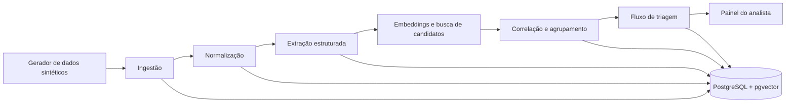
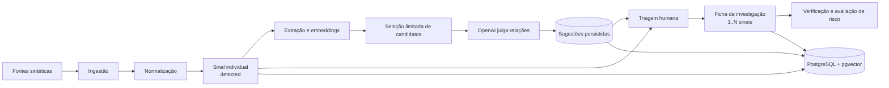

# Arquitetura

## Visão e princípio

O VBE Hub será um monólito modular: uma aplicação implantável, com módulos internos independentes e contratos explícitos. Essa escolha reduz a complexidade de operação até a validação e preserva pontos de extensão para conectores e provedores de IA futuros.

## Estado atual e arquitetura alvo

O primeiro diagrama representa o pipeline implementado antes da ADR-010. Ele permanece executável
durante a migração, mas a consolidação automática não será a unidade canônica futura.



A arquitetura alvo preserva ingestão, normalização e fichas técnicas, mas transforma cada fonte em
um sinal individual. Relações são preparadas antecipadamente e a ficha nasce somente de decisão
humana:



O [contrato de transição](signal-domain-transition.md) distingue comportamento existente, modelo
alvo e sequência expand/contract.

## Camadas e módulos

| Camada | Módulos | Responsabilidade |
| --- | --- | --- |
| Interface | detectados, detalhe do sinal, relacionados, ficha, mapa | Explicar evidências e capturar decisão humana. |
| API | sinais, sugestões, fichas, revisões, métricas | Expor dados ao painel e coordenar casos de uso. |
| Domínio | normalização, triagem, correlação, composição humana, prioridade | Aplicar regras sem depender de web, banco ou provedor de IA. |
| Processamento | gerador, extração, embeddings, lote | Executar tarefas demoradas fora da requisição web. |
| Adapters | PostgreSQL, OpenAI, adapters históricos, EIOS futuro, GdS futuro | Isolar dependências externas. |

## Stack proposta

- Backend: Python e FastAPI.
- Processamento em lote: Celery e Redis; o uso pode começar síncrono para o primeiro experimento pequeno e migrar antes do lote massivo.
- Persistência: PostgreSQL com extensão `pgvector`, SQLAlchemy 2.x nos adapters e Alembic para migrations.
- Frontend: Next.js/React em `frontend/`; Leaflet fica encapsulado no adaptador territorial,
  carregado sob demanda e sem tiles externos obrigatórios.
- Execução local: Docker Compose.

## Docker como fronteira operacional

Docker Compose é o contrato oficial entre a aplicação e o dispositivo de validação. O fluxo suportado não pressupõe runtimes ou bancos instalados diretamente no host.

Na composição atual, os serviços de aplicação são:

```text
frontend ────────► api ────────► postgres + pgvector
                       │                 ▲
                       └────────► redis
generator/importer ──────────────────────┘
```

- `api`: imagem do backend FastAPI, também usada para comandos de migrations, testes e utilitários quando adequado;
- `frontend`: imagem Next.js não privilegiada, com health check próprio e configuração pública da
  URL da API sem segredos;
- `postgres`: banco com versão fixada e extensão pgvector habilitada;
- `redis`: infraestrutura preparada para filas e cache posteriores;
- `generator/importer`: comando ou serviço de execução finita que gera e importa dados sintéticos sem exigir Python no host.

O worker será incorporado à mesma composição em seu milestone. A composição deve ser inicializada
por um comando documentado e oferecer dois modos:

- desenvolvimento: volumes de código e recarga automática, sem comprometer o caminho reproduzível;
- validação/demonstração: imagens construídas, dataset e semente identificados, sem dependência do ambiente do desenvolvedor.

## Painel do analista: plano de integração

O frontend executável ainda representa consolidados. A substituição visual e os contratos abaixo
são o alvo aprovado, não comportamento já entregue:

1. **Detectados**: fila filtrável e paginada com um card por fonte/sinal individual.
2. **Investigação do sinal**: detalhe da fonte, ficha técnica, proveniência, auditoria e aba de
   relacionados pré-calculados.
3. **Ficha de investigação**: conjunto confirmado pelo analista, mantendo cada membro separado.
4. **Panorama**: leitura operacional e territorial agregada, declarando se conta sinais ou fichas.
5. **Fluxo**: visão complementar em quadro ou tabela, sem criar uma segunda máquina de estados.

Os componentes devem preservar divulgação progressiva de informação. O item compacto mostra
código, tipo e emissor da fonte, estado, condição/sintomas-chave, local e período. Justificativas,
relacionados, campos ausentes, ficha técnica e texto de origem pertencem ao detalhe. Prioridade
passa a ser atributo da ficha, não do sinal ainda detectado.

### Visualizações de fluxo

A tabela/fila é a visão principal porque permite comparar filtros e evidências de forma densa. A
visão de fluxo precisa distinguir sinais em `detected`/`triage` de fichas em `verification`,
`risk_assessment` ou `closed`; ela não pode contá-los como uma única entidade. Não há transição por
arrastar e soltar. Toda ação é validada no backend e registrada como evento de decisão humana.

### Visualização geoespacial

O mapa exibirá somente localização agregada por bairro ou outra unidade
administrativa aprovada para a demonstração. Não exibirá coordenada de relato individual,
endereço, identificação da pessoa ou inferência de localização precisa. Marcadores ou polígonos
apresentarão contagens separadas de sinais e fichas, estado predominante e prioridade sugerida das fichas;
selecionar uma área filtrará ou encaminhará para a fila correspondente.

Leaflet está encapsulado em um adaptador de mapa carregado apenas na rota territorial. Para manter a
demonstração reproduzível sem Internet, a primeira versão usa geometria esquemática versionada no
frontend e não solicita tiles externos. A lista textual oferece todas as operações essenciais por
teclado e leitor de tela; mapa sem dados, geometria indisponível e filtro sem resultado continuam
compreensíveis sem mapa-base.

### Contratos de integração previstos

O frontend não acessa tabelas do banco diretamente. Após a #71, a API deverá expor, com paginação,
filtros e versões explícitas quando aplicável:

- fila com um sinal por fonte e campos de leitura rápida;
- detalhe individual, ficha técnica, proveniência, sugestões relacionadas e ficha ativa;
- comando humano para criar ou alterar a composição da ficha;
- resumo geoespacial agregado por área em `GET /signals/geographic-summary`, sem registros
  individualizados;
- resumo operacional reconciliável em `GET /metrics/summary`, com proveniência, defasagem,
  falhas e avaliações sintéticas explicitamente separadas de interpretação epidemiológica;
- comando de revisão humana que aplica a máquina de estados e retorna o evento de auditoria.

A interface tratará indisponibilidade, carregamento, resposta vazia e conflito de versão sem
inventar dados ou concluir decisão sanitária. Dados sintéticos permanecem visualmente marcados em
todas as telas da PoC.

### Invariantes operacionais

- Imagens-base usam versões explícitas; não usar tags flutuantes como `latest`.
- Serviços possuem health checks e dependências condicionadas a prontidão, não apenas ordem de inicialização.
- Migrations são executadas por comando idempotente e falham visivelmente.
- Segredos entram apenas por variáveis/arquivos ignorados; não são incorporados às imagens.
- Volumes nomeados, portas, comandos de reset e consequências de limpeza são documentados.
- Testes e lint possuem comandos em contêiner equivalentes aos checks da CI.
- O modo de validação pode operar com provider falso ou resultado previamente gerado quando a API externa não estiver disponível, deixando essa condição explícita.

## IA: decisão operacional

A camada de aplicação depende das portas `StructuredExtractor`, `EmbeddingProvider` e
`RelationJudge`; domínio e aplicação não dependem do SDK de um provedor.

- Após a migração da ADR-010, OpenAI será o único provedor externo do caminho oficial para
  extração, embeddings e julgamento de relação.
- Gemini e Ollama permanecem apenas como implementações/evidências históricas ou experimentais e
  não serão necessários para executar a PoC.
- Não usar LLM para comparar todos os pares: a busca vetorial e filtros temporal/geográfico geram candidatos; a IA julga somente os candidatos promissores.
- Toda resposta de IA deve registrar modelo, versão do prompt, entrada resumida, saída validada, tempo, erro e decisão humana posterior.
- A aba de relacionados lê resultados persistidos; abrir a interface não inicia processamento
  síncrono no provedor.

Uma GTX 1650 de 4 GB suporta experimentação com modelos pequenos quantizados e embeddings, mas não deve ser a única estratégia para a extração clínica multilíngue em grande lote. A qualidade será medida, não presumida.

## Consolidação legada e composição humana

O módulo de consolidação atual permanece como legado reproduzível durante a migração. No modelo
alvo, nenhuma relação da IA une sinais automaticamente. O analista seleciona membros e cria uma
ficha que referencia cada sinal, sem gerar campos que substituam as descrições individuais.
Consulte a [ADR-010](decisions/ADR-010-individual-signals-human-investigation.md) e o
[mapa de transição](signal-domain-transition.md).

A prioridade sugerida será calculada para a ficha, sem LLM, por pesos e faixas versionados.
Score, confiança dos dados e futura avaliação humana são conceitos e contratos diferentes. Cada
componente aponta para evidências de origem e campos desconhecidos permanecem explícitos. Consulte
o [contrato de prioridade](suggested-priority.md) e a
[ADR-007](decisions/ADR-007-rules-based-suggested-priority.md).

## Fluxo de estado

`detected → triage → verification → risk_assessment → closed`

No modelo alvo, `detected` e `triage` pertencem ao sinal individual; após a composição humana,
`verification`, `risk_assessment` e `closed` pertencem à ficha. A transição de responsabilidade é
atômica e auditável. Abrir uma tela não muda estado.

O `workflow-v1` atualmente implementado permanece durante a compatibilidade. O `workflow-v2`
preservará versão otimista, idempotência e eventos imutáveis ao transferir a responsabilidade do
sinal para a ficha. Aceitação, correção e rejeição preservam valor anterior, novo valor e vínculo
com a origem. Consulte o [contrato de revisão humana](human-review-workflow.md) e a
[ADR-008](decisions/ADR-008-append-only-human-review.md).

## Fontes futuras e dados sintéticos

O EIOS trabalha com inteligência de fontes abertas e notícias em múltiplas fontes/idiomas. O Guardiões da Saúde é uma plataforma de vigilância participativa, cujos reportes são compilados para análise de sintomas e doenças. Os contratos sintéticos refletem essas características, mas serão revisados antes de qualquer conector real, pois os endpoints, permissões e campos disponíveis precisam de confirmação com cada provedor.

Fontes de domínio: [WHO EIOS](https://www.who.int/initiatives/eios) e
[ProEpi Guardiões da Saúde](https://proepi.org.br/guardians-of-health/). A decisão de provedor está
registrada nas ADR-002 e ADR-010, sem tornar documentação externa parte do contrato do domínio.
