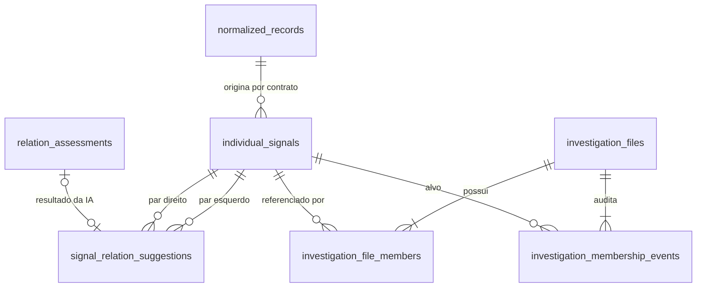

# Persistência de sinais individuais e fichas de investigação

## O que esta etapa entrega

A migration `20261108_0008` expande o banco sem remover o modelo anterior. Cada registro
normalizado elegível pode originar um sinal individual por versão de contrato. Fichas de
investigação referenciam esses sinais; não copiam nem fundem título, descrição, ficha técnica ou
proveniência.

Sugestões de relação e decisões humanas ocupam entidades diferentes. Uma linha em
`signal_relation_suggestions` informa o estado antecipado da análise (`pending`, `ready` ou
`failed`) e pode apontar para a avaliação versionada da IA. Somente ações humanas criam vínculos em
`investigation_file_members` e eventos em `investigation_membership_events`.

A migration `20261108_0009` adiciona as máquinas `workflow-v2`. Um gatilho cria
`individual_signal_workflows` em `detected` na mesma transação do sinal; o backfill cobre sinais já
existentes. `investigation_workflows` só nasce quando o analista confirma a passagem para
`verification`. `workflow_v2_events` preserva as duas trilhas com chave idempotente global,
sequência por unidade, versão otimista e bloqueio de `UPDATE`/`DELETE`.

Esta entrega cria a base persistente. O pipeline assíncrono e a [API versionada de sinais
individuais](individual-signal-api.md) já usam essas tabelas; workflow completo e nova interface
serão implementados nas issues seguintes da milestone 7.

## Diagrama lógico



## Invariantes no PostgreSQL

- `(normalized_record_id, contract_version)` é único: reprocessar a mesma fonte não duplica o
  sinal.
- Os pares de sugestões são canônicos e únicos por versão; índices dos dois lados atendem à aba de
  relacionados sem chamada síncrona à IA.
- Um sinal possui no máximo um vínculo ativo, garantido por índice único parcial.
- A ficha usa versão otimista; uma escrita com versão antiga falha sem registrar evento parcial.
- Inclusão, remoção e rejeição são eventos sequenciais e append-only. Trigger impede `UPDATE` e
  `DELETE` no histórico.
- Remover o último membro é rejeitado pelo repositório. Transferências futuras devem remover e
  adicionar na mesma transação.
- As tabelas `consolidated_signals`, `signal_members`, `signal_workflows` e `review_events`
  permanecem intactas e legíveis durante a transição.
- Estados iniciais e eventos de workflow-v2 são criados na mesma transação de suas mudanças; abrir
  detalhes não materializa nem avança workflow.

## Backfill não destrutivo

Ao subir a migration, registros em `normalized_records` com estado `succeeded` recebem um sinal no
contrato `individual-signal-v1`. O identificador do backfill é determinístico; repetir a migration
ou a criação pelo repositório não produz uma segunda linha devido à constraint de unicidade.

O backfill não cria fichas, não aceita sugestões e não altera registros legados. Assim, uma decisão
humana nunca é inferida a partir de agrupamentos automáticos antigos.

## Subida, verificação e reversão

O Compose continua sendo a interface oficial:

```bash
docker compose build migrate
docker compose run --rm migrate uv run --no-sync alembic upgrade head
docker compose --profile tools run --build --rm integration-test \
  uv run --no-sync pytest tests/integration/persistence/test_investigation_schema.py \
  tests/integration/persistence/test_investigation_repository.py
```

Para validar reversibilidade em ambiente isolado ou descartável:

```bash
docker compose run --rm migrate uv run --no-sync alembic downgrade 20261006_0007
docker compose run --rm migrate uv run --no-sync alembic upgrade head
```

O downgrade remove somente as cinco tabelas introduzidas pela migration. Ele não apaga o modelo
legado, mas remove fichas e decisões gravadas no modelo novo; por isso não deve ser executado sobre
um ambiente compartilhado sem backup e autorização explícita. O upgrade seguinte refaz somente o
backfill de sinais, nunca decisões humanas.

## Limites

Os dados usados pela PoC continuam sintéticos. O esquema não implementa autenticação, autorização,
retenção institucional nem validade clínica/epidemiológica. Sugestões de IA são apoio auditável e
nunca confirmação de evento ou prioridade sanitária.
