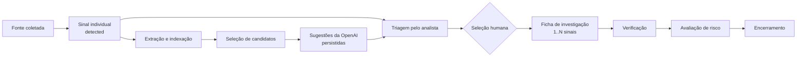
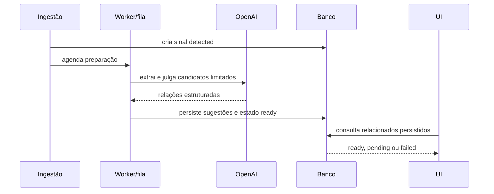

# Transição para sinais individuais e fichas de investigação

## Situação

A ADR-010 está aceita e a expansão persistente da issue #69 está implementada. O comportamento
público ainda usa `consolidated_signals`; pipeline, API, workflow e frontend permanecem em
transição nas issues #70 a #77. Este documento não deve ser usado para alegar que a troca completa
do modelo já ocorreu.

## Glossário normativo

| Termo | Definição | Autoridade |
| --- | --- | --- |
| Sinal | Uma fonte coletada e preservada individualmente. | Sistema detecta; analista avalia. |
| Sugestão de relação | Classificação da IA entre dois sinais candidatos. | IA sugere; não associa. |
| Ficha de investigação | Unidade de trabalho criada pelo analista com um ou mais sinais. | Analista cria e corrige. |
| Membro | Vínculo de um sinal com uma ficha, sem cópia destrutiva. | Analista decide. |
| Prioridade sugerida | Ordenação explicável da ficha. | Sistema sugere; profissional decide. |

“Caso” não será usado como nome de entidade, para não sugerir caso clínico confirmado.

## Fluxo alvo

Abrir o detalhe ou a aba não altera estado. Sem candidatos confirmados, o analista pode criar uma
ficha com o sinal principal e prosseguir.

## Propriedade do workflow

| Momento | Unidade | Estado |
| --- | --- | --- |
| Após coleta | Sinal | `detected` |
| Análise inicial | Sinal | `triage` |
| Composição confirmada | Ficha | transição atômica para `verification` |
| Investigação conjunta | Ficha | `verification` ou `risk_assessment` |
| Fim | Ficha | `closed` |

O sinal associado mantém referência à ficha ativa e o histórico anterior. Ele deixa a fila de
detectados, mas não é excluído nem perde URL própria. A modelagem exata da transição será entregue
em #69 e #72 com controle de versão e eventos append-only. Remover um membro o devolve à triagem;
uma ficha não pode ficar vazia. Transferência entre fichas deve ser uma operação atômica.

## Leitura rápida de relacionados

A implementação poderá atualizar a tela por polling limitado ou revalidação. WebSocket não é uma
decisão necessária para a PoC. A leitura nunca inicia fan-out de chamadas ao provedor.

## Mapa de impacto

| Área atual | Estado durante a transição | Destino |
| --- | --- | --- |
| `raw_records` e `normalized_records` | Preservados. | Origem do sinal individual. |
| `technical_sheet_extractions` | Preservada por registro. | Ficha técnica do sinal. |
| `consolidated_signals` e membros | Legado somente leitura até validação. | Substituídos por sinais e fichas. |
| avaliações de relação | Preservadas e versionadas. | Sugestões, não agrupamento automático. |
| prioridade por sinal consolidado | Legada. | Prioridade por ficha de investigação. |
| workflow por consolidado | Legado durante compatibilidade. | Sinal em detecção/triagem; ficha depois. |
| `GET /signals` atual | Mantido até contrato novo. | Um item por fonte/sinal. |
| detalhe atual | Mantido até contrato novo. | Sinal, relacionados e ficha ativa separados. |
| frontend atual | Preservado até smoke/equivalência. | Fundação nova e fluxo revisado. |
| n8n atual | Evidência histórica. | Entradas separadas sem associação automática. |

## Sequência expand/contract

1. **Definir:** ADR-010 e contratos conceituais (#68).
2. **Expandir:** adicionar novas tabelas e índices sem remover legados (#69, concluída no código).
3. **Preparar:** processar sugestões assíncronas com OpenAI (#70).
4. **Controlar:** implementar workflow e eventos novos (#72).
5. **Expor:** adicionar API nova mantendo compatibilidade temporária (#71).
6. **Migrar interface:** importar a fundação aprovada e integrar o fluxo (#73–#75).
7. **Migrar demonstração:** adaptar fixtures e n8n (#76).
8. **Validar:** medir qualidade, custo, latência e reconciliação (#77).
9. **Contrair:** retirar contratos legados somente após evidência e decisão explícita em issue
   própria; não faz parte da #68.

## Invariantes de aceite da migração

- Nenhuma descrição ou proveniência individual é perdida.
- A mesma fonte não cria sinais duplicados em reprocessamento idêntico.
- Nenhuma sugestão da IA cria ou modifica ficha sem comando humano.
- Um sinal não pertence a duas fichas ativas.
- Leitura de relacionados não depende de chamada síncrona externa.
- Eventos anteriores permanecem consultáveis após correção.
- Contagens de sinais e fichas são publicadas separadamente.
- Reset, backfill e retirada de legado exigem comandos documentados e testes em banco isolado.

## Questões adiadas, sem bloquear o domínio

- autenticação, papéis e autorização institucionais;
- notificações em tempo real além de polling/revalidação;
- política de retenção para dados reais;
- integrações reais com EIOS e Guardiões da Saúde;
- deploy de produção e alta disponibilidade.
